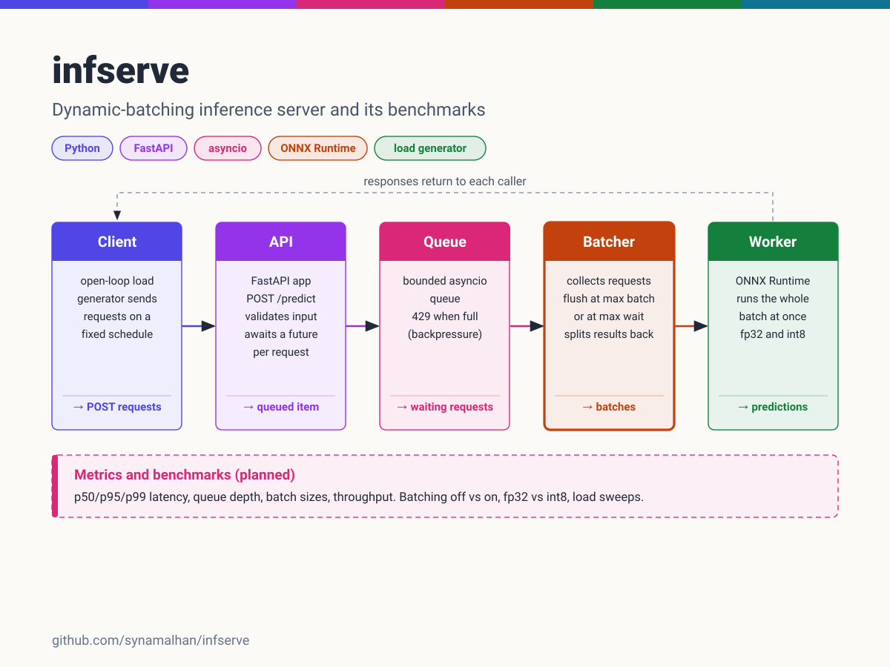

# infserve

Dynamic-batching inference server and its benchmarks.

> **Status: in progress.** This repo currently holds the design only. Nothing is implemented yet, and no numbers are reported until they are measured.

infserve serves a model behind a FastAPI endpoint. An asyncio batcher groups requests and runs them together on ONNX Runtime. The benchmarks measure what batching actually buys under load.

## Architecture

## Plan

- [ ] FastAPI `POST /predict` endpoint
- [ ] Bounded queue that returns 429 when full
- [ ] Dynamic batcher: flush on max batch size or max wait
- [ ] ONNX Runtime worker, fp32 and int8
- [ ] Open-loop load generator
- [ ] Metrics: p50/p95/p99 latency, queue depth, batch sizes, throughput
- [ ] Benchmarks and write-up

## Benchmarks (planned)

Batching off vs on, fp32 vs int8, and load sweeps. Results will be added only after they are measured.

## Planned stack

Python, FastAPI, asyncio, ONNX Runtime.
